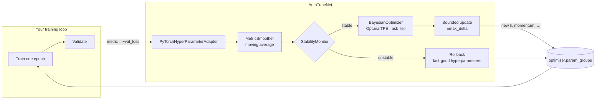
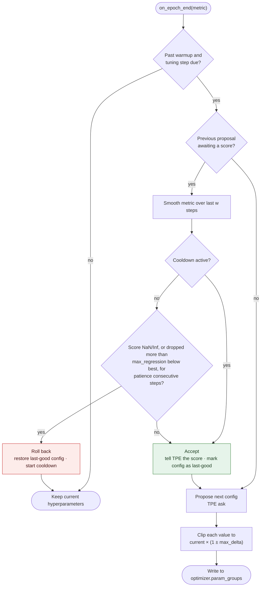
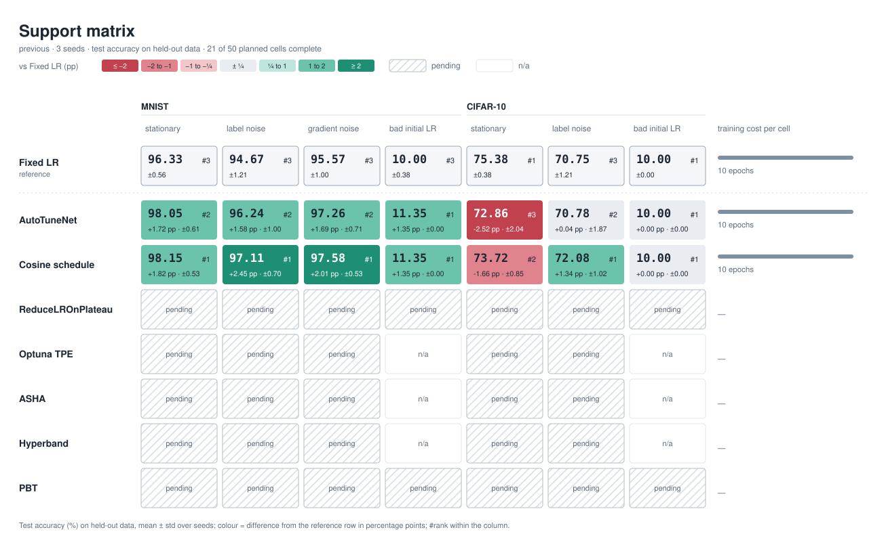

<div align="center">

# AutoTuneNet: Online Hyperparameter Adaptation

Training-time Bayesian hyperparameter tuning for PyTorch, with rollback-based stability safeguards.

[](https://github.com/mitishraina/AutoTuneNet/actions/workflows/ci.yml)
[](https://www.python.org/)
[](https://pytorch.org/)
[](LICENSE)

[Overview](#overview) · [Method](#method) · [Installation](#installation) · [Quick Start](#quick-start) · [Benchmarks](#benchmarks) · [Reproducing Results](#reproducing-results) · [Citation](#citation)

</div>

<p align="center">
  
</p>

---

## Abstract

Hyperparameters such as the learning rate are usually chosen before training and either stay fixed or follow a pre-defined schedule. Training dynamics, however, are non-stationary: the best hyperparameters change over the course of a run, and long-running jobs are expensive to restart. AutoTuneNet treats hyperparameter tuning as an online control problem inside a single training run. A Bayesian optimizer (Optuna TPE, ask–tell) proposes new hyperparameters at each tuning step. Proposals are applied with bounded updates, scored on a smoothed validation signal, and checked by a stability monitor that rolls back to the last known-good configuration when performance regresses consistently. The core is model- and dataset-agnostic and attaches to an existing PyTorch training loop through a single per-epoch call. The repository also includes AutoTuneNet-Bench, a benchmark suite for evaluating Online Hyperparameter Adaptation (OHA) under controlled non-stationarity.

## Overview

| | Offline HPO (grid / random / BO) | LR schedulers | AutoTuneNet (OHA) |
|---|---|---|---|
| When tuning happens | Before training, across many runs | During training, open-loop | During training, closed-loop |
| Restarts required | Yes (one per trial) | No | No |
| Reacts to observed metrics | Between trials only | No (except plateau-based) | Yes, every tuning step |
| Safety against harmful updates | N/A | N/A | Warmup, bounded updates, rollback, cooldown |

AutoTuneNet is:
- a generic, framework-agnostic optimization core with a thin PyTorch adapter,
- a closed-loop controller for hyperparameters (e.g. `lr`, `momentum`, `weight_decay`),
- intended for settings where stability and restart-free training matter more than peak accuracy.

AutoTuneNet is not:
- a model, an AutoML system, or Neural Architecture Search,
- a replacement for offline HPO when you can afford many full runs (see [Benchmark 4](#legacy-benchmarks-benchmarks)),
- population-based training (it operates within a single run).

## Method

AutoTuneNet sits between your training loop and the PyTorch optimizer. Once per tuning step it reads a validation metric, decides whether the last change helped, and writes new hyperparameters into `optimizer.param_groups`.



Decision logic for a single tuning step (`adapter.on_epoch_end(metric)`):



Design choices:
- **Hyperparameter-only rollback.** Rollback restores the *tuned hyperparameters*, not model weights or optimizer state. This keeps the method cheap and framework-independent. The cost: rollback cannot undo divergence that has already happened in the weights (see [Limitations](#limitations)).
- **Patience and cooldown.** A rollback needs `patience` consecutive regressions, so a single noisy measurement doesn't trigger one. After a rollback, a `cooldown` window suppresses further rollbacks to avoid oscillation.
- **Framework-agnostic core.** `BayesianOptimizer`, `ParameterSpace` and `StabilityMonitor` have no dependency on PyTorch. Only the adapter does.

A formal problem statement for OHA is in [docs/OHA.md](docs/OHA.md).

## Installation

Requires Python ≥ 3.10.

```bash
# From PyPI
pip install autotunenet          # or: uv add autotunenet

# From source (recommended for research / reproducing benchmarks)
git clone https://github.com/mitishraina/AutoTuneNet.git
cd AutoTuneNet
uv sync                          # creates .venv from uv.lock, installs the package + dev tools
```

Development uses [uv](https://docs.astral.sh/uv/). `uv sync` installs the exact versions pinned in `uv.lock`, and `uv run <cmd>` runs a command inside the project environment. If you don't use uv, `pip install -e .` still works.

Dependencies: `optuna`, `torch`, `torchvision`, `pyyaml`.

## Quick Start

```python
import torch
import torch.nn as nn
import torch.optim as optim

from autotunenet.parameters import ParameterSpace
from autotunenet.bayesian_optimizer import BayesianOptimizer
from autotunenet.adapters.pytorch.adapter import PyTorchHyperParameterAdapter

model = nn.Linear(10, 1)
optimizer = optim.Adam(model.parameters(), lr=1e-2)

# Ranges: (low, high) is linear; {"low", "high", "log": True} samples evenly across
# orders of magnitude (use it for lr). A list [a, b, c] is a set of categorical choices.
param_space = ParameterSpace({"lr": {"low": 1e-4, "high": 1e-1, "log": True}})
autotune = BayesianOptimizer(param_space, seed=42, smoothing_window=3)

adapter = PyTorchHyperParameterAdapter(
    torch_optimizer=optimizer,
    autotune_optimizer=autotune,
    tune_n_steps=1,      # tune every epoch
    warmup_epochs=2,     # no tuning during the first 2 epochs
    max_delta=0.5,       # at most ±50% change per tuning step
)

for epoch in range(20):
    train_one_epoch(model, optimizer)          # your code
    val_loss = evaluate(model)                 # your code
    adapter.on_epoch_end(metric=-val_loss)     # higher is better

    print(f"epoch {epoch:02d} | lr={optimizer.param_groups[0]['lr']:.6f}")
```

The adapter changes `optimizer.param_groups` in place, so the rest of your training loop stays the same. After each call you can check `adapter.last_rollback` to see whether that step triggered a rollback.

### Multi-parameter tuning

```python
optimizer = optim.SGD(model.parameters(), lr=1e-2, momentum=0.9, weight_decay=1e-4)

param_space = ParameterSpace({
    "lr":           {"low": 1e-4, "high": 1e-1, "log": True},
    "momentum":     (0.80, 0.99),
    "weight_decay": {"low": 1e-5, "high": 1e-3, "log": True},
})
```

Any numeric key in `optimizer.param_groups` can be tuned. Keys that the optimizer doesn't have are ignored.

### Configuring the stability monitor

```python
from autotunenet.safeguards.stability import StabilityMonitor

autotune.guard = StabilityMonitor(
    max_regression=0.2,  # relative drop from best smoothed score counted as a regression
    patience=2,          # consecutive regressions before rollback
    cooldown=3,          # tuning steps with rollback suppressed afterwards
)
```

### Config-driven tuning

```python
from autotunenet.factory import build_pytorch_autotunenet

adapter = build_pytorch_autotunenet(
    torch_optimizer=optimizer,
    raw_config={
        "parameter_space": {"lr": {"low": 1e-4, "high": 1e-2, "log": True}},
        "tuning":    {"tune_n_steps": 1, "warmup_epochs": 2, "max_delta": 0.5},
        "metrics":   {"smoothing_window": 3},
        "stability": {"max_regression": 0.2, "patience": 2, "cooldown": 3},
    },
    seed=42,
)
```

The same config can live in a YAML file:

```yaml
parameter_space:
  lr: {low: 1e-4, high: 1e-1, log: true}   # continuous range, log scale
  weight_decay: {low: 1e-5, high: 1e-3, log: true}
  # momentum: {choices: [0.8, 0.9, 0.95]}  # categorical (SGD only: Adam has no momentum)
tuning:
  tune_n_steps: 1
  warmup_epochs: 2
  max_delta: 0.5
metrics:
  smoothing_window: 3
stability:
  max_regression: 0.2
  patience: 2
  cooldown: 3
```

```python
adapter = PyTorchHyperParameterAdapter.from_config(optimizer, "autotune.yaml", seed=42)
```

Every tuned name must be a setting of your optimizer's param groups (`lr`, `weight_decay`, `momentum` for SGD, and so on); an unknown name raises an error listing the settings that exist. In a config, `[low, high]` always means a continuous range on a linear scale, `{low, high, log: true}` a log-scale range, and categorical values must be written as `{choices: [...]}`. In the Python `ParameterSpace` API, a tuple is a linear range, a `{"low", "high", "log"}` mapping a (log-scale) range, and a list is categorical. See [docs/CONFIGURATION.md](docs/CONFIGURATION.md).

## Hyperparameters of AutoTuneNet

| Parameter | Component | Default | Description |
|---|---|---|---|
| `tune_n_steps` | Adapter | `1` | Tune every *n* calls (epochs or steps) |
| `warmup_epochs` | Adapter | `0` | Epochs before tuning starts |
| `warmup_metric_threshold` | Adapter | `None` | Tuning starts once the validation loss is at or below this value (must be > 0) |
| `max_delta` | Adapter | `None` | Max relative change per step, in `(0, 1)` |
| `smoothing_window` | Optimizer | `3` | Moving-average window used by the stability check |
| `max_regression` | StabilityMonitor | `0.2` | Relative regression threshold |
| `patience` | StabilityMonitor | `2` | Consecutive bad steps before rollback |
| `cooldown` | StabilityMonitor | `3` | Steps with rollback suppressed after a rollback |

## Benchmarks

### Support matrix

<p align="center">
  
</p>

Fixed LR is the reference row at the top. Every other cell shows the test accuracy on the held-out split (mean ± std over 3 seeds), its difference from Fixed LR in percentage points and its rank in the column; the colour is that difference (teal = better, rose = worse, grey = about the same). Hatched **pending** cells have not been run yet, and n/a marks a scenario that does not apply to the method. The filled cells are the earlier runs (Apple MPS), imported with `uv run python -m benchmarks.legacy_import`; the remaining methods are run with the new harness (see [docs/BENCHMARKING.md](docs/BENCHMARKING.md)). To redraw it with progress against the full plan:

```bash
uv run python -m benchmarks.report --experiment previous --plan benchmarks/experiments/comparison.yaml
```

### Previous results

> These results were produced by the previous benchmark scripts (archived in [`benchmarks/results/legacy/`](benchmarks/results/legacy/)). They will be replaced by the head-to-head comparison run with the new harness.

All numbers are **mean ± std over 3 seeds (42, 43, 44)**, 10-epoch runs with small CNNs, trained on Apple MPS. **Test accuracy** is measured on the held-out test split, which no method uses for tuning or model selection. These results describe controller behaviour (stability, adaptation, overhead); they are not state-of-the-art claims. Per-seed values: [`benchmarks/results/legacy/autotunenet_bench/summary.json`](benchmarks/results/legacy/autotunenet_bench/summary.json) and [`benchmarks/results/legacy/results_summary.json`](benchmarks/results/legacy/results_summary.json).

AutoTuneNet uses the same settings everywhere: log-scale `lr` search (`[1e-4, 1e-1]` on MNIST, `[1e-4, 1e-3]` on CIFAR-10), `n_startup_trials = 3`, `warmup_epochs = 2`, `max_delta = 0.5`, `smoothing_window = 3`, `max_regression = 0.2`, `patience = 2`, `cooldown = 3`. All methods use Adam.

#### A shift in the middle of training

The shift starts at epoch 5. Regret is the cumulative validation-loss difference against fixed LR, summed over epochs (negative is better).

| Setting | Controller | Test acc ↑ | Final val loss ↓ | Post-shift degradation ↓ | Rollbacks | Regret vs fixed LR ↓ |
|---|---|---|---|---|---|---|
| MNIST, 30% label noise | Fixed LR (1e-2) | 94.67 ± 1.21 | 0.559 ± 0.006 | 0.451 ± 0.010 | 0 | — |
| | Cosine scheduler | **97.11 ± 0.70** | **0.478 ± 0.025** | **0.403 ± 0.005** | 0 | **−0.343 ± 0.066** |
| | AutoTuneNet | 96.24 ± 1.00 | 0.526 ± 0.055 | 0.423 ± 0.044 | 1.0 | −0.113 ± 0.080 |
| MNIST, gradient noise (σ = 0.02) | Fixed LR (1e-2) | 95.57 ± 1.00 | 0.159 ± 0.022 | 0.061 ± 0.003 | 0 | — |
| | Cosine scheduler | **97.58 ± 0.53** | **0.092 ± 0.010** | **−0.002 ± 0.014** | 0 | **−0.422 ± 0.081** |
| | AutoTuneNet | 97.26 ± 0.71 | 0.099 ± 0.024 | 0.001 ± 0.013 | 0.3 | −0.276 ± 0.216 |
| CIFAR-10, 30% label noise | Fixed LR (1e-3) | 70.75 ± 1.21 | 1.079 ± 0.021 | 0.248 ± 0.027 | 0 | — |
| | Cosine scheduler | **72.08 ± 1.02** | **1.048 ± 0.023** | **0.217 ± 0.003** | 0 | **−0.253 ± 0.153** |
| | AutoTuneNet | 70.78 ± 1.87 | 1.075 ± 0.049 | 0.231 ± 0.006 | 0.7 | −0.139 ± 0.108 |

AutoTuneNet's controller overhead is about 1 ms per epoch.

#### Stationary training and stress test

| Method | MNIST test acc ↑ | CIFAR-10 test acc ↑ | Training epochs | Restarts |
|---|---|---|---|---|
| Fixed LR | 96.33 ± 0.56 | **75.38 ± 0.38** | 10 | 0 |
| Cosine scheduler | 98.15 ± 0.53 | 73.72 ± 0.85 | 10 | 0 |
| AutoTuneNet | 98.05 ± 0.61 | 72.86 ± 2.04 | 10 | 0 |
| Offline HPO (8 trials × 3 epochs, then a 10-epoch run) | **98.98 ± 0.19** | 74.60 ± 0.68 | 34 | 8 |
| *Stress test, initial LR = 0.1:* Fixed LR / Scheduler / AutoTuneNet | 10.00 / 11.35 / 11.35 | 10.00 / 10.00 / 10.00 | 10 | 0 |

The four figures from the original paper, regenerated from these runs (MNIST shown; CIFAR-10 versions are in [`benchmarks/results/legacy/figures/paper_figures/`](benchmarks/results/legacy/figures/paper_figures/)):

<p align="center">
  
  
  
  
</p>

**Observations.**
1. **Under a shift, AutoTuneNet beats a fixed learning rate on MNIST and matches it on CIFAR-10.** Its regret against fixed LR is negative in all three settings, by +1.6 and +1.7 points of test accuracy on MNIST.
2. **The cosine scheduler is still the strongest controller in every shift setting.** Under gradient noise AutoTuneNet is within one standard deviation of it (97.26 ± 0.71 vs 97.58 ± 0.53).
3. **AutoTuneNet learns a decaying schedule.** On stationary MNIST it lowers the learning rate from 0.01 to about 0.001 (Fig. 3), much like the cosine schedule, and reaches the same accuracy (98.05 vs 98.15) without being told the schedule.
4. **On stationary CIFAR-10 a fixed learning rate wins.** Ten epochs are too few for this model to benefit from decay; AutoTuneNet lowers the learning rate early and has the lowest mean and the largest spread (72.86 ± 2.04).
5. **Offline HPO finds the best MNIST configuration, at 3.4× the training cost and 8 restarts.**
6. **No method recovers from the stress test.** Every method ends at chance accuracy. Rolling back hyperparameters can't repair weights that have already diverged.

## Reproducing Results

### Datasets

Datasets are not stored in the repository. Each benchmark downloads what it needs the first time it runs, into `data/` at the repository root (set `AUTOTUNENET_DATA_DIR` to use another folder). The terminal shows which dataset is being fetched, its size, and a progress bar with percentage, speed and time remaining:

```text
[data] CIFAR-10 (training split) not found in /path/to/AutoTuneNet/data.
[data] Downloading CIFAR-10 (about 170 MB) from www.cs.toronto.edu (this server can be slow). This happens once.
 43%|████▎     | 73.4M/170M [00:41<00:52, 1.85MB/s]
[data] CIFAR-10 ready in /path/to/AutoTuneNet/data
```

To fetch everything before running anything:

```bash
uv run python -m benchmarks.download_data                 # MNIST (~11 MB) and CIFAR-10 (~170 MB)
uv run python -m benchmarks.download_data --task cifar10  # just one
```

### Running

All benchmarks run through one harness. An experiment file lists the methods, tasks, scenarios and seeds; each combination is one *cell*.

```bash
# Unit tests (include an end-to-end run of every method and scenario on a tiny synthetic task)
uv run pytest

# Run an experiment. Results: benchmarks/results/<experiment>/<method>/<task>/<scenario>/seed_<s>.json
uv run python -m benchmarks.run --experiment benchmarks/experiments/comparison.yaml

# Useful options
#   --list                 show the cells (and which are done) without running anything
#   --shard 2/4            run a quarter of the cells, e.g. on four machines or notebooks
#   --method autotunenet   only some methods (also --task, --scenario; all repeatable)
#   --device auto|cpu|cuda|mps
# Finished cells are skipped, so an interrupted run resumes where it stopped.

# Mean ± std over seeds, support matrix (SVG) and figures -> benchmarks/results/<experiment>/report/
uv run python -m benchmarks.report --experiment comparison
```

`benchmarks/experiments/smoke.yaml` runs every method and scenario on the toy task in about a second, a quick way to check a change. How the harness is organised, and how to add a method, task or scenario: [docs/BENCHMARKING.md](docs/BENCHMARKING.md).

## Repository Structure

```
AutoTuneNet/
├── src/autotunenet/
│   ├── bayesian_optimizer.py   # Optuna-TPE ask–tell optimizer + smoothing + guard
│   ├── parameters.py           # ParameterSpace (continuous ranges / categorical)
│   ├── metrics.py              # Moving-average metric smoother
│   ├── factory.py              # build_pytorch_autotunenet (config → adapter)
│   ├── safeguards/             # StabilityMonitor, Rollback
│   ├── adapters/pytorch/       # PyTorchHyperParameterAdapter + hooks
│   ├── config/                 # Config schema, loader, defaults.yaml
│   └── logging/                # Structured logging and tracking
├── benchmarks/                 # Benchmark harness
│   ├── core/                   # Trainer, compute ledger, result schema, registries, experiment files
│   ├── tasks/                  # mnist, cifar10, toy (synthetic, for tests)
│   ├── scenarios/              # stationary, label_noise, gradient_noise, bad_initial_lr
│   ├── methods/                # fixed_lr, cosine, autotunenet, ...
│   ├── experiments/            # comparison.yaml, smoke.yaml
│   ├── run.py · aggregate.py · download_data.py
│   └── results/                # outputs; legacy/ holds the previous results
├── docs/                       # Quickstart, configuration, PyTorch guide, OHA definition, FAQ
├── examples/                   # Minimal runnable examples
├── tests/                      # Unit tests (core, safeguards, adapter, config, factory)
├── pyproject.toml              # Package metadata, dependencies, dev dependency group
├── uv.lock                     # Pinned dependency versions
└── CITATION.cff                # Citation metadata (GitHub "Cite this repository")
```

## Limitations

- **Three seeds, small models, short runs.** The numbers come from 3 seeds, 10-epoch runs and lightweight CNNs. Several differences are within one standard deviation.
- **Hyperparameter-only rollback.** Model weights and optimizer state are not restored, so divergence that has already happened is not undone.
- **Epoch-level control.** Tuning happens at a coarse granularity (per epoch or per `tune_n_steps` calls). Instability inside an epoch isn't detected until the epoch ends.
- **Few tuning steps.** Tuning once per epoch gives TPE at most 8 observations in a 10-epoch run. The benchmarks lower `n_startup_trials` to 3 so the model is used at all; the library default stays at Optuna's 10.
- **Non-stationary objective.** TPE assumes a stationary objective, but here the score of a configuration depends on *when* it is evaluated. Smoothing and bounded updates reduce this mismatch but don't remove it.

## Contributing

Issues and pull requests are welcome. New benchmark regimes, controllers and framework adapters are the most useful contributions. Please open an issue before starting larger changes. New features should come with tests (`uv run pytest`).

## License

This project is released under the [MIT License](LICENSE).

## Acknowledgements

AutoTuneNet builds on [Optuna](https://optuna.org/) (TPE sampler, ask–tell API) and [PyTorch](https://pytorch.org/).

## Citation

If you use AutoTuneNet or AutoTuneNet-Bench in your research, please cite:

```bibtex
@software{raina2025autotunenet,
  author    = {Raina, Mitish},
  title     = {{AutoTuneNet}: Online Hyperparameter Adaptation},
  year      = {2025},
  version   = {1.0.2},
  url       = {https://github.com/mitishraina/AutoTuneNet},
  license   = {MIT}
}
```
