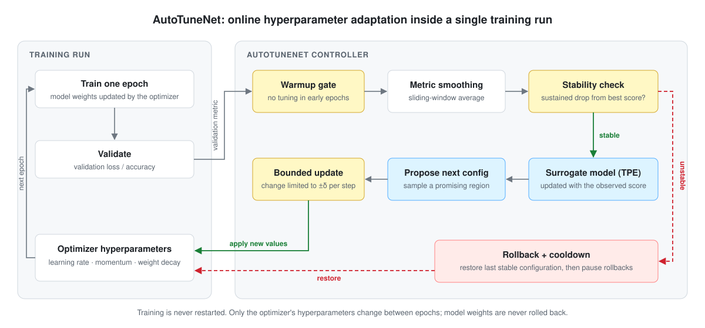
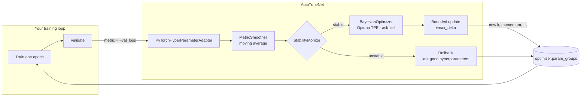
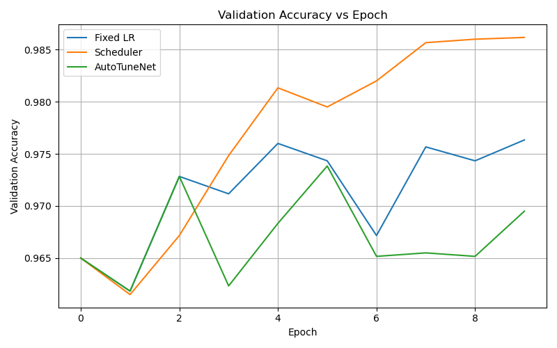
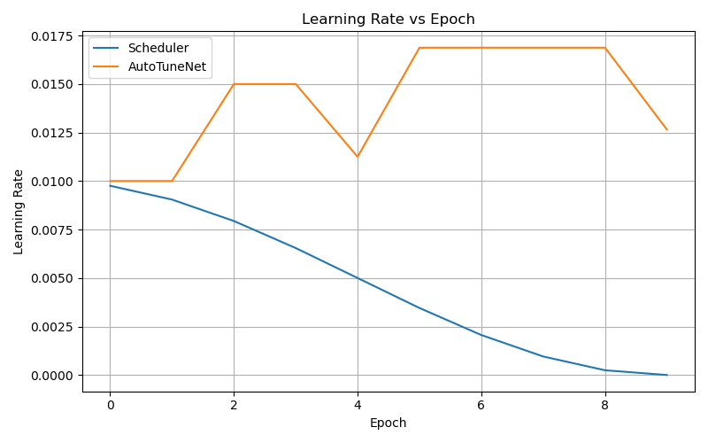

<div align="center">

# AutoTuneNet: Online Hyperparameter Adaptation

Training-time Bayesian hyperparameter tuning for PyTorch, with rollback-based stability safeguards.

[](https://github.com/mitishraina/AutoTuneNet/actions/workflows/ci.yml)
[](https://www.python.org/)
[](https://pytorch.org/)
[](LICENSE)

[Overview](#overview) · [Method](#method) · [Installation](#installation) · [Quick Start](#quick-start) · [Benchmarks](#benchmarks) · [Reproducing Results](#reproducing-results) · [Citation](#citation)

</div>

<p align="center">
  
</p>

---

## Abstract

Hyperparameters such as the learning rate are usually chosen before training and either stay fixed or follow a pre-defined schedule. Training dynamics, however, are non-stationary: the best hyperparameters change over the course of a run, and long-running jobs are expensive to restart. AutoTuneNet treats hyperparameter tuning as an online control problem inside a single training run. A Bayesian optimizer (Optuna TPE, ask–tell) proposes new hyperparameters at each tuning step. Proposals are applied with bounded updates, scored on a smoothed validation signal, and checked by a stability monitor that rolls back to the last known-good configuration when performance regresses consistently. The core is model- and dataset-agnostic and attaches to an existing PyTorch training loop through a single per-epoch call. The repository also includes AutoTuneNet-Bench, a benchmark suite for evaluating Online Hyperparameter Adaptation (OHA) under controlled non-stationarity.

## Overview

| | Offline HPO (grid / random / BO) | LR schedulers | AutoTuneNet (OHA) |
|---|---|---|---|
| When tuning happens | Before training, across many runs | During training, open-loop | During training, closed-loop |
| Restarts required | Yes (one per trial) | No | No |
| Reacts to observed metrics | Between trials only | No (except plateau-based) | Yes, every tuning step |
| Safety against harmful updates | N/A | N/A | Warmup, bounded updates, rollback, cooldown |

AutoTuneNet is:
- a generic, framework-agnostic optimization core with a thin PyTorch adapter,
- a closed-loop controller for hyperparameters (e.g. `lr`, `momentum`, `weight_decay`),
- intended for settings where stability and restart-free training matter more than peak accuracy.

AutoTuneNet is not:
- a model, an AutoML system, or Neural Architecture Search,
- a replacement for offline HPO when you can afford many full runs (see [Benchmark 4](#legacy-benchmarks-benchmarks)),
- population-based training (it operates within a single run).

## Method

AutoTuneNet sits between your training loop and the PyTorch optimizer. Once per tuning step it reads a validation metric, decides whether the last change helped, and writes new hyperparameters into `optimizer.param_groups`.



Decision logic for a single tuning step (`adapter.on_epoch_end(metric)`):


Design choices:
- **Hyperparameter-only rollback.** Rollback restores the *tuned hyperparameters*, not model weights or optimizer state. This keeps the method cheap and framework-independent. The cost: rollback cannot undo divergence that has already happened in the weights (see [Limitations](#limitations)).
- **Patience and cooldown.** A rollback needs `patience` consecutive regressions, so a single noisy measurement doesn't trigger one. After a rollback, a `cooldown` window suppresses further rollbacks to avoid oscillation.
- **Framework-agnostic core.** `BayesianOptimizer`, `ParameterSpace` and `StabilityMonitor` have no dependency on PyTorch. Only the adapter does.

A formal problem statement for OHA is in [docs/OHA.md](docs/OHA.md).

## Installation

Requires Python ≥ 3.10.

```bash
# From PyPI
pip install autotunenet          # or: uv add autotunenet

# From source (recommended for research / reproducing benchmarks)
git clone https://github.com/mitishraina/AutoTuneNet.git
cd AutoTuneNet
uv sync                          # creates .venv from uv.lock, installs the package + dev tools
```

Development uses [uv](https://docs.astral.sh/uv/). `uv sync` installs the exact versions pinned in `uv.lock`, and `uv run <cmd>` runs a command inside the project environment. If you don't use uv, `pip install -e .` still works.

Dependencies: `optuna`, `torch`, `torchvision`, `pyyaml`.

## Quick Start

```python
import torch
import torch.nn as nn
import torch.optim as optim

from autotunenet.parameters import ParameterSpace
from autotunenet.bayesian_optimizer import BayesianOptimizer
from autotunenet.adapters.pytorch.adapter import PyTorchHyperParameterAdapter

model = nn.Linear(10, 1)
optimizer = optim.Adam(model.parameters(), lr=1e-2)

# Ranges: (low, high) is linear; {"low", "high", "log": True} samples evenly across
# orders of magnitude (use it for lr). A list [a, b, c] is a set of categorical choices.
param_space = ParameterSpace({"lr": {"low": 1e-4, "high": 1e-1, "log": True}})
autotune = BayesianOptimizer(param_space, seed=42, smoothing_window=3)

adapter = PyTorchHyperParameterAdapter(
    torch_optimizer=optimizer,
    autotune_optimizer=autotune,
    tune_n_steps=1,      # tune every epoch
    warmup_epochs=2,     # no tuning during the first 2 epochs
    max_delta=0.5,       # at most ±50% change per tuning step
)

for epoch in range(20):
    train_one_epoch(model, optimizer)          # your code
    val_loss = evaluate(model)                 # your code
    adapter.on_epoch_end(metric=-val_loss)     # higher is better

    print(f"epoch {epoch:02d} | lr={optimizer.param_groups[0]['lr']:.6f}")
```

The adapter changes `optimizer.param_groups` in place, so the rest of your training loop stays the same. After each call you can check `adapter.last_rollback` to see whether that step triggered a rollback.

### Multi-parameter tuning

```python
optimizer = optim.SGD(model.parameters(), lr=1e-2, momentum=0.9, weight_decay=1e-4)

param_space = ParameterSpace({
    "lr":           {"low": 1e-4, "high": 1e-1, "log": True},
    "momentum":     (0.80, 0.99),
    "weight_decay": {"low": 1e-5, "high": 1e-3, "log": True},
})
```

Any numeric key in `optimizer.param_groups` can be tuned. Keys that the optimizer doesn't have are ignored.

### Configuring the stability monitor

```python
from autotunenet.safeguards.stability import StabilityMonitor

autotune.guard = StabilityMonitor(
    max_regression=0.2,  # relative drop from best smoothed score counted as a regression
    patience=2,          # consecutive regressions before rollback
    cooldown=3,          # tuning steps with rollback suppressed afterwards
)
```

### Config-driven tuning

```python
from autotunenet.factory import build_pytorch_autotunenet

adapter = build_pytorch_autotunenet(
    torch_optimizer=optimizer,
    raw_config={
        "parameter_space": {"lr": {"low": 1e-4, "high": 1e-2, "log": True}},
        "tuning":    {"tune_n_steps": 1, "warmup_epochs": 2, "max_delta": 0.5},
        "metrics":   {"smoothing_window": 3},
        "stability": {"max_regression": 0.2, "patience": 2, "cooldown": 3},
    },
    seed=42,
)
```

The same config can live in a YAML file:

```yaml
parameter_space:
  lr: {low: 1e-4, high: 1e-1, log: true}   # continuous range, log scale
  momentum: {low: 0.8, high: 0.99}     # continuous range, explicit form
  # batch_size: {choices: [32, 64]}    # categorical
tuning:
  tune_n_steps: 1
  warmup_epochs: 2
  max_delta: 0.5
metrics:
  smoothing_window: 3
stability:
  max_regression: 0.2
  patience: 2
  cooldown: 3
```

```python
adapter = PyTorchHyperParameterAdapter.from_config(optimizer, "autotune.yaml", seed=42)
```

In a config, `[low, high]` always means a continuous range on a linear scale, `{low, high, log: true}` a log-scale range, and categorical values must be written as `{choices: [...]}`. In the Python `ParameterSpace` API, a tuple is a linear range, a `{"low", "high", "log"}` mapping a (log-scale) range, and a list is categorical. See [docs/CONFIGURATION.md](docs/CONFIGURATION.md).

## Hyperparameters of AutoTuneNet

| Parameter | Component | Default | Description |
|---|---|---|---|
| `tune_n_steps` | Adapter | `1` | Tune every *n* calls (epochs or steps) |
| `warmup_epochs` | Adapter | `0` | Epochs before tuning starts |
| `warmup_metric_threshold` | Adapter | `None` | Tuning starts only once `metric ≥ −threshold` |
| `max_delta` | Adapter | `None` | Max relative change per step, in `(0, 1)` |
| `smoothing_window` | Optimizer | `5` (`3` via config) | Moving-average window over observed metrics |
| `max_regression` | StabilityMonitor | `0.2` | Relative regression threshold |
| `patience` | StabilityMonitor | `2` | Consecutive bad steps before rollback |
| `cooldown` | StabilityMonitor | `3` | Steps with rollback suppressed after a rollback |

## Benchmarks

All results are single-seed (seed = 42), 10-epoch runs with a small CNN. They show how the controller behaves (stability, recovery, overhead). They are not state-of-the-art claims.

### AutoTuneNet-Bench: non-stationary training

Setup: Adam optimizer, a shift injected at epoch 5, and the same controller settings for every AutoTuneNet run: `warmup_epochs = 2`, `max_delta = 0.5`, `smoothing_window = 3`, `max_regression = 0.2`, `patience = 2`, `cooldown = 3`. The learning-rate range is `[1e-4, 1e-1]` on MNIST and `[1e-4, 1e-3]` on CIFAR-10. The CIFAR-10 config also lists momentum and weight decay, but these have no effect: Adam has no `momentum` setting and a weight decay of 0 cannot move under `max_delta`. Each comparison was run on a single device (MNIST on CPU, CIFAR-10 on Apple MPS); the device and PyTorch version are recorded in each run's `run_info.json`. Full protocol: [autotunenet_bench/AUTOTUNENET_BENCH.md](autotunenet_bench/AUTOTUNENET_BENCH.md).

**Label noise** (30% of training labels randomized from epoch 5):

| Task | Controller | Final val acc ↑ | Best val acc ↑ | Final val loss ↓ | Rollbacks | Overhead / epoch |
|---|---|---|---|---|---|---|
| MNIST | Fixed LR (1e-2) | 95.38 | 97.25 | 0.556 | 0 | 0.003 ms |
| MNIST | Cosine scheduler | **97.80** | **97.80** | **0.435** | 0 | 0.017 ms |
| MNIST | AutoTuneNet | 94.22 | 96.73 | 0.602 | 1 | 0.68 ms |
| CIFAR-10 | Fixed LR (1e-3) | 69.16 | 70.34 | 1.056 | 0 | 0.006 ms |
| CIFAR-10 | AutoTuneNet | **70.54** | **70.54** | **1.053** | 1 | 2.0 ms |

There is no scheduler config for CIFAR-10 yet.

**Gradient noise** (Gaussian noise, σ = 0.02, added to every gradient from epoch 5):

| Task | Controller | Final val acc ↑ | Best val acc ↑ | Final val loss ↓ | Rollbacks | Overhead / epoch |
|---|---|---|---|---|---|---|
| MNIST | Fixed LR (1e-2) | 95.98 | 97.25 | 0.147 | 0 | 0.003 ms |
| MNIST | Cosine scheduler | **98.02** | **98.10** | **0.077** | 0 | 0.017 ms |
| MNIST | AutoTuneNet | 11.10 | 96.73 | 2.301 | 1 | 0.74 ms |

Cumulative regret vs. fixed LR (sum over epochs of the val-loss difference, controller − baseline; negative is better): +0.630 on MNIST with label noise and +10.934 on MNIST with gradient noise (AutoTuneNet's validation loss was higher than fixed LR's at every epoch after warmup), and −0.092 on CIFAR-10 (lower in 4 of the 5 post-shift epochs). ([results/compute_regret/](autotunenet_bench/results/compute_regret/))

> **Note on post-shift metrics.** `stability_metrics.json` also reports post-shift degradation and loss spike. These columns are left out above because the code that computes them uses a contaminated baseline (it includes post-shift losses). They will return once that is fixed.

### Legacy benchmarks (`benchmarks/`)

Stationary MNIST, Adam, batch size 64, 10 epochs, seed 42. Details in [benchmarks/BENCHMARKS.md](benchmarks/BENCHMARKS.md). The scripts in `benchmarks/` are currently set to CIFAR-10. The stored results below come from their earlier MNIST configuration and predate the fixes above. The AutoTuneNet rows in particular were produced before TPE was told the values that actually ran, so treat them as historical.

| Benchmark | Method | Final val acc ↑ | Best val acc ↑ | Final val loss ↓ | Restarts |
|---|---|---|---|---|---|
| 1. Baseline | Fixed LR (1e-2) | 97.63 | 97.63 | 0.091 | 0 |
| 2. Scheduler | CosineAnnealingLR | **98.62** | 98.62 | **0.055** | 0 |
| 4. Offline HPO | Optuna, 8 trials × 3 epochs | 98.17 | **99.08** | 0.106 | 8 |
| — | AutoTuneNet (`lr ∈ [1e-4, 1e-1]`, warmup 2, `max_delta` 0.5) | 9.58 | 97.28 | 2.313 | 0 |
| 3. Stress test (initial LR = 0.1) | Fixed LR / Cosine / AutoTuneNet | 9.58 / 11.10 / 9.58 | 11.10 (all) | 2.31 / 2.30 / 2.31 | 0 |

<p align="center">
  
  
</p>

**Observations.**
1. **The cosine scheduler is the strongest controller in every MNIST setting.** It has the best final accuracy and loss under both label noise and gradient noise.
2. **On CIFAR-10, AutoTuneNet beat fixed LR.** It finished at 70.54% against 69.16%, with lower validation loss in 4 of the 5 epochs after the shift. Its search range sits below the starting learning rate, so its proposals moved the learning rate down (0.001 to about 0.0005), which suits noisy labels.
3. **Learning-rate drift is AutoTuneNet's main failure mode on MNIST.** In both MNIST runs the learning rate climbed from 0.01 to 0.034 in three tuning steps (`max_delta = 0.5` allows ×1.5 per step) and validation loss doubled before the shift. The stability monitor rolled back once, but only one step (to 0.0225). Under gradient noise the model then diverged to chance and did not recover.
4. **The tuner has not left its random phase.** Optuna's TPE sampler makes random proposals for its first 10 trials (`n_startup_trials`). A 10-epoch run with 2 warmup epochs gets at most 8 tuning steps, so every proposal in these benchmarks is a random draw, not a model-based one. The Bayesian part of the method is not exercised at this run length.
5. **Rollback can't repair lost capacity.** Restoring hyperparameters doesn't recover weights that have already diverged (gradient-noise run, legacy stress test).

## Reproducing Results

```bash
# Unit tests
uv run pytest

# AutoTuneNet-Bench: one config = one run; outputs go to autotunenet_bench/results/<config_name>/
# The dataset and model are chosen by the `task` field (mnist | cifar10) in each config.
# --device auto|cpu|cuda|mps (default auto: CUDA, then Apple MPS, then CPU). Compare runs only within one device.
uv run python -m autotunenet_bench.run_benchmarks --config autotunenet_bench/configs/mnist_fixed_lr.yaml
uv run python -m autotunenet_bench.run_benchmarks --config autotunenet_bench/configs/mnist_scheduler.yaml
uv run python -m autotunenet_bench.run_benchmarks --config autotunenet_bench/configs/mnist_autotunenet.yaml
uv run python -m autotunenet_bench.run_benchmarks --config autotunenet_bench/configs/mnist_gradient_noise_fixed_lr.yaml
uv run python -m autotunenet_bench.run_benchmarks --config autotunenet_bench/configs/mnist_gradient_noise_scheduler.yaml
uv run python -m autotunenet_bench.run_benchmarks --config autotunenet_bench/configs/mnist_gradient_noise_autotunenet.yaml
uv run python -m autotunenet_bench.run_benchmarks --config autotunenet_bench/configs/cifar_fixed_lr.yaml
uv run python -m autotunenet_bench.run_benchmarks --config autotunenet_bench/configs/cifar_autotunenet.yaml
uv run python -m autotunenet_bench.metrics.compute_regret

# Legacy benchmarks
uv run python -m benchmarks.fixed_lr.run
uv run python -m benchmarks.scheduler.run
uv run python -m benchmarks.offline_hpo.run
uv run python -m benchmarks.autotunenet.run
uv run python -m benchmarks.stress_test.run
```

Each AutoTuneNet-Bench run writes `epoch_metric.json`, `stability_metrics.json`, `compute_metrics.json` and `run_info.json` (device, PyTorch version, seed). All configs set a fixed seed. MNIST and CIFAR-10 are downloaded by `torchvision` into `data/`.

## Repository Structure

```
AutoTuneNet/
├── src/autotunenet/
│   ├── bayesian_optimizer.py   # Optuna-TPE ask–tell optimizer + smoothing + guard
│   ├── parameters.py           # ParameterSpace (continuous ranges / categorical)
│   ├── metrics.py              # Moving-average metric smoother
│   ├── factory.py              # build_pytorch_autotunenet (config → adapter)
│   ├── safeguards/             # StabilityMonitor, Rollback
│   ├── adapters/pytorch/       # PyTorchHyperParameterAdapter + hooks
│   ├── config/                 # Config schema, loader, defaults.yaml
│   └── logging/                # Structured logging and tracking
├── autotunenet_bench/          # AutoTuneNet-Bench: tasks, regimes, controllers, metrics, configs, results
├── benchmarks/                 # Legacy benchmarks: fixed_lr, scheduler, offline_hpo, stress_test, autotunenet
├── docs/                       # Quickstart, configuration, PyTorch guide, OHA definition, FAQ
├── examples/                   # Minimal runnable examples
├── tests/                      # Unit tests (core, safeguards, adapter, config, factory)
├── pyproject.toml              # Package metadata, dependencies, dev dependency group
├── uv.lock                     # Pinned dependency versions
└── CITATION.cff                # Citation metadata (GitHub "Cite this repository")
```

## Limitations

- **Single seed, small models.** The reported numbers come from one seed with lightweight CNNs. Treat them as qualitative evidence.
- **Hyperparameter-only rollback.** Model weights and optimizer state are not restored, so divergence that has already happened is not undone.
- **Epoch-level control.** Tuning happens at a coarse granularity (per epoch or per `tune_n_steps` calls). Instability inside an epoch isn't detected until the epoch ends.
- **Short runs keep TPE in its random phase.** With the default 10 start-up trials, runs with fewer than about 10 tuning steps never use the TPE model.
- **Non-stationary objective.** TPE assumes a stationary objective, but here the score of a configuration depends on *when* it is evaluated. Smoothing and bounded updates reduce this mismatch but don't remove it.

## Contributing

Issues and pull requests are welcome. New benchmark regimes, controllers and framework adapters are the most useful contributions. Please open an issue before starting larger changes. New features should come with tests (`uv run pytest`).

## License

This project is released under the [MIT License](LICENSE).

## Acknowledgements

AutoTuneNet builds on [Optuna](https://optuna.org/) (TPE sampler, ask–tell API) and [PyTorch](https://pytorch.org/).

## Citation

If you use AutoTuneNet or AutoTuneNet-Bench in your research, please cite:

```bibtex
@software{raina2025autotunenet,
  author    = {Raina, Mitish},
  title     = {{AutoTuneNet}: Online Hyperparameter Adaptation},
  year      = {2025},
  version   = {1.0.2},
  url       = {https://github.com/mitishraina/AutoTuneNet},
  license   = {MIT}
}
```
