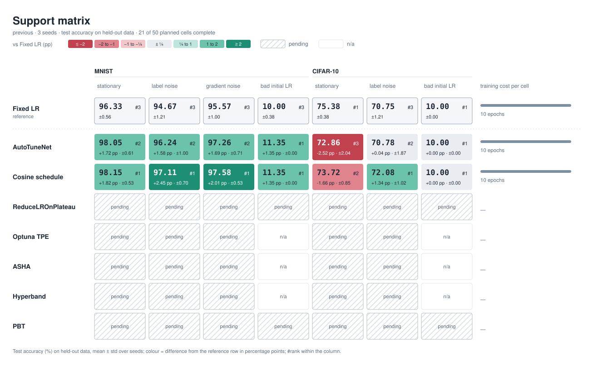
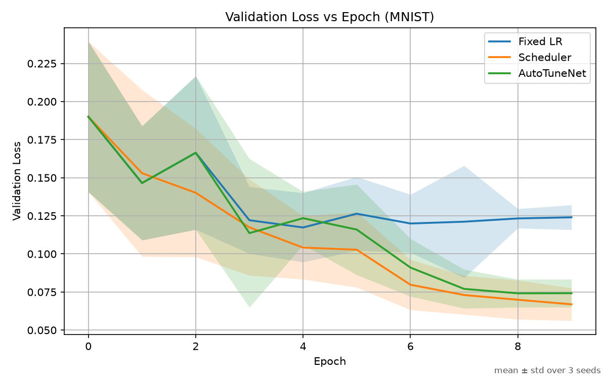
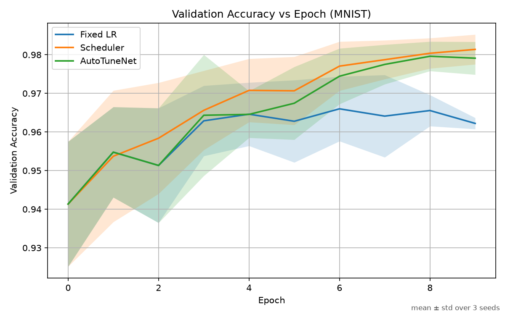
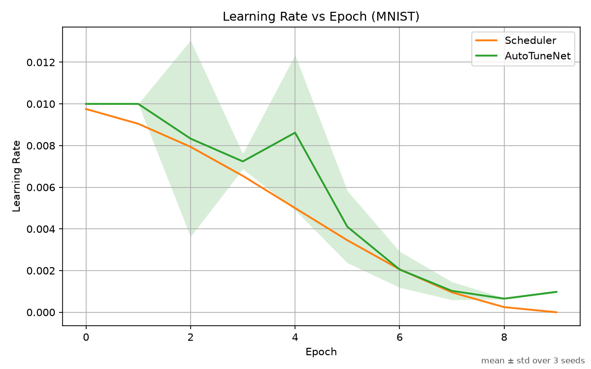
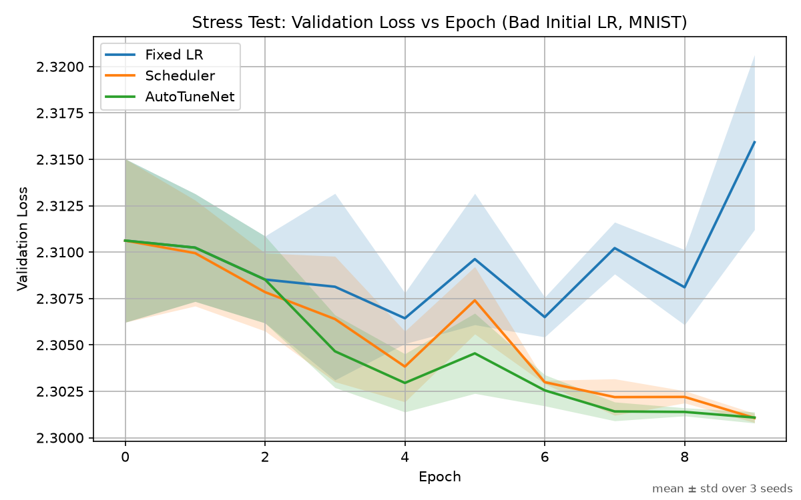

# Results

What has been run so far, where every number comes from, and how to check it.

## Support matrix

<p align="center">
  
</p>

Fixed LR is the reference row at the top. Every other cell shows:

- the test accuracy on the held-out split (mean ± std over 3 seeds);
- its difference from Fixed LR in percentage points;
- its rank in the column.

The colour encodes that difference: teal is better, rose is worse and grey is within ±0.25 pp. Hatched **pending** cells have not been run yet. **n/a** marks a scenario that does not apply to the method (offline search methods pick their own learning rate, so a bad initial one means nothing to them). The last column is each method's training cost, as epochs trained on a log scale, with the number of models trained in parallel and restarts. The filled cells are the previous runs; the full comparison (`autotunenet run --experiment comparison`) fills the rest.

Redraw it:

```bash
autotunenet report --experiment previous --plan comparison
```

## Result folders

| Folder | Contents |
|---|---|
| [`legacy/`](https://github.com/mitishraina/AutoTuneNet/tree/main/benchmarks/results/legacy/) | Raw output of the earlier benchmark scripts (Apple MPS, 3 seeds), kept unchanged |
| [`previous/`](https://github.com/mitishraina/AutoTuneNet/tree/main/benchmarks/results/previous/) | `legacy/` converted to the current result format by `benchmarks/legacy_import.py`; feeds the matrix above |
| [`pilot/`](https://github.com/mitishraina/AutoTuneNet/tree/main/benchmarks/results/pilot/) | A small Kaggle run used to time the methods; includes its notebook |
| `comparison/` | The full comparison, once run, with the Kaggle notebooks that produced it |

## Verifying a result

Each `seed_<s>.json` is one training run. It records:

- **Metrics:** the test metrics and the per-epoch history (learning rate, losses, accuracy).
- **Compute:** epochs trained, models trained in parallel, trials, restarts, wall time.
- **Environment:** device, accelerator, PyTorch and CUDA versions, git commit.
- **Configuration:** the method's arguments and the scenario's parameters.

Runs made on Kaggle also have their notebooks under `notebooks/`, with the exact install line and the list of cells each GPU ran. To reproduce a cell on your own hardware:

```bash
autotunenet run --experiment comparison --method autotunenet --task mnist --scenario label_noise
```

Every method except PBT is bit-reproducible for a given seed and device type. PBT members run concurrently, so the timing of synchronisation can change which member is copied.

## Previous results

> These results were produced by the previous benchmark scripts (archived in [`benchmarks/results/legacy/`](https://github.com/mitishraina/AutoTuneNet/tree/main/benchmarks/results/legacy/)). They will be replaced by the head-to-head comparison run with the new harness.

All numbers are **mean ± std over 3 seeds (42, 43, 44)**, 10-epoch runs with small CNNs, trained on Apple MPS. **Test accuracy** is measured on the held-out test split, which no method uses for tuning or model selection. These results describe controller behaviour (stability, adaptation, overhead); they are not state-of-the-art claims. Per-seed values: [`benchmarks/results/legacy/autotunenet_bench/summary.json`](https://github.com/mitishraina/AutoTuneNet/blob/main/benchmarks/results/legacy/autotunenet_bench/summary.json) and [`benchmarks/results/legacy/results_summary.json`](https://github.com/mitishraina/AutoTuneNet/blob/main/benchmarks/results/legacy/results_summary.json).

AutoTuneNet uses the same settings everywhere: log-scale `lr` search (`[1e-4, 1e-1]` on MNIST, `[1e-4, 1e-3]` on CIFAR-10), `n_startup_trials = 3`, `warmup_epochs = 2`, `max_delta = 0.5`, `smoothing_window = 3`, `max_regression = 0.2`, `patience = 2`, `cooldown = 3`. All methods use Adam.

### A shift in the middle of training

The shift starts at epoch 5. Regret is the cumulative validation-loss difference against fixed LR, summed over epochs (negative is better).

| Setting | Controller | Test acc ↑ | Final val loss ↓ | Post-shift degradation ↓ | Rollbacks | Regret vs fixed LR ↓ |
|---|---|---|---|---|---|---|
| MNIST, 30% label noise | Fixed LR (1e-2) | 94.67 ± 1.21 | 0.559 ± 0.006 | 0.451 ± 0.010 | 0 | — |
| | Cosine scheduler | **97.11 ± 0.70** | **0.478 ± 0.025** | **0.403 ± 0.005** | 0 | **−0.343 ± 0.066** |
| | AutoTuneNet | 96.24 ± 1.00 | 0.526 ± 0.055 | 0.423 ± 0.044 | 1.0 | −0.113 ± 0.080 |
| MNIST, gradient noise (σ = 0.02) | Fixed LR (1e-2) | 95.57 ± 1.00 | 0.159 ± 0.022 | 0.061 ± 0.003 | 0 | — |
| | Cosine scheduler | **97.58 ± 0.53** | **0.092 ± 0.010** | **−0.002 ± 0.014** | 0 | **−0.422 ± 0.081** |
| | AutoTuneNet | 97.26 ± 0.71 | 0.099 ± 0.024 | 0.001 ± 0.013 | 0.3 | −0.276 ± 0.216 |
| CIFAR-10, 30% label noise | Fixed LR (1e-3) | 70.75 ± 1.21 | 1.079 ± 0.021 | 0.248 ± 0.027 | 0 | — |
| | Cosine scheduler | **72.08 ± 1.02** | **1.048 ± 0.023** | **0.217 ± 0.003** | 0 | **−0.253 ± 0.153** |
| | AutoTuneNet | 70.78 ± 1.87 | 1.075 ± 0.049 | 0.231 ± 0.006 | 0.7 | −0.139 ± 0.108 |

AutoTuneNet's controller overhead is about 1 ms per epoch.

### Stationary training and stress test

| Method | MNIST test acc ↑ | CIFAR-10 test acc ↑ | Training epochs | Restarts |
|---|---|---|---|---|
| Fixed LR | 96.33 ± 0.56 | **75.38 ± 0.38** | 10 | 0 |
| Cosine scheduler | 98.15 ± 0.53 | 73.72 ± 0.85 | 10 | 0 |
| AutoTuneNet | 98.05 ± 0.61 | 72.86 ± 2.04 | 10 | 0 |
| Offline HPO (8 trials × 3 epochs, then a 10-epoch run) | **98.98 ± 0.19** | 74.60 ± 0.68 | 34 | 8 |
| *Stress test, initial LR = 0.1:* Fixed LR / Scheduler / AutoTuneNet | 10.00 / 11.35 / 11.35 | 10.00 / 10.00 / 10.00 | 10 | 0 |

The four figures from the original paper, regenerated from these runs (MNIST shown; CIFAR-10 versions are in [`benchmarks/results/legacy/figures/paper_figures/`](https://github.com/mitishraina/AutoTuneNet/tree/main/benchmarks/results/legacy/figures/paper_figures/)):

<p align="center">
  
  
  
  
</p>

**Observations.**

1. **Under a shift, AutoTuneNet beats a fixed learning rate on MNIST and matches it on CIFAR-10.** Its regret against fixed LR is negative in all three settings, by +1.6 and +1.7 points of test accuracy on MNIST.
2. **The cosine scheduler is still the strongest controller in every shift setting.** Under gradient noise AutoTuneNet is within one standard deviation of it (97.26 ± 0.71 vs 97.58 ± 0.53).
3. **AutoTuneNet learns a decaying schedule.** On stationary MNIST it lowers the learning rate from 0.01 to about 0.001 (Fig. 3), much like the cosine schedule, and reaches the same accuracy (98.05 vs 98.15) without being told the schedule.
4. **On stationary CIFAR-10 a fixed learning rate wins.** Ten epochs are too few for this model to benefit from decay; AutoTuneNet lowers the learning rate early and has the lowest mean and the largest spread (72.86 ± 2.04).
5. **Offline HPO finds the best MNIST configuration, at 3.4× the training cost and 8 restarts.**
6. **No method recovers from the stress test.** Every method ends at chance accuracy. Rolling back hyperparameters can't repair weights that have already diverged.
