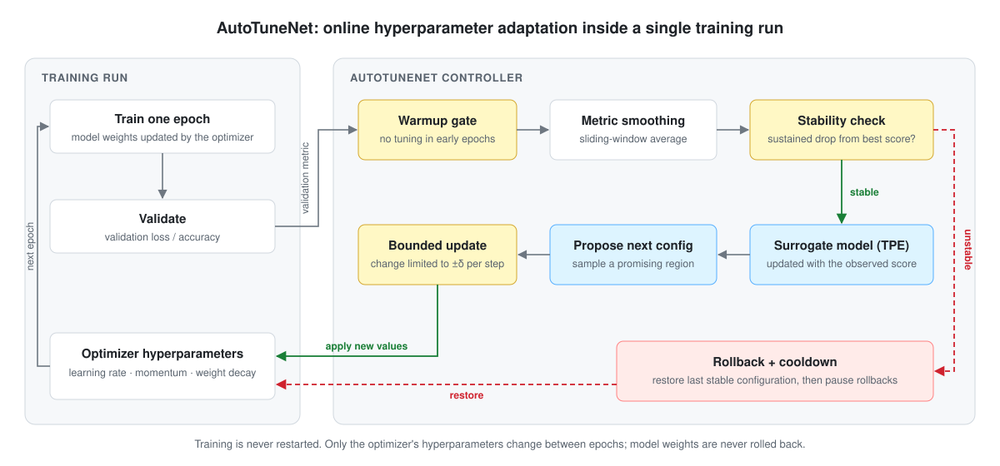
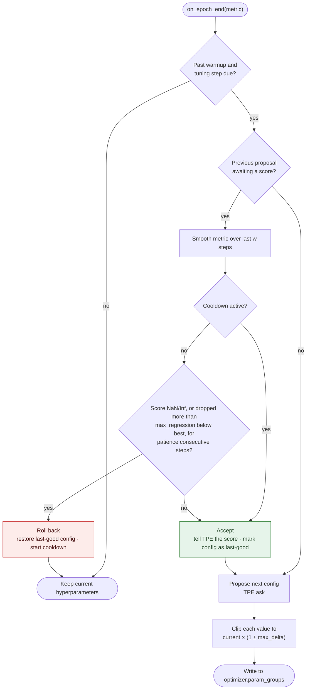

# How it works

This page describes exactly what happens on each tuning call, which guarantees follow from that, and which don't. It is written for readers who want to predict the controller's behaviour or extend it.

## Components

| Component | Module | Depends on PyTorch | Role |
|---|---|---|---|
| `ParameterSpace` | `autotunenet.parameters` | no | Names, ranges (linear or log) and categorical choices |
| `BayesianOptimizer` | `autotunenet.bayesian_optimizer` | no | TPE ask–tell, smoothing, stability check, rollback target |
| `MetricSmoother` | `autotunenet.metrics` | no | Moving average over the last `smoothing_window` scores |
| `StabilityMonitor` | `autotunenet.safeguards.stability` | no | Regression detection with patience and cooldown |
| `Rollback` | `autotunenet.safeguards.rollback` | no | Stores the last accepted, non-regressing configuration |
| `PyTorchHyperParameterAdapter` | `autotunenet.adapters.pytorch.adapter` | yes | Warmup, tuning interval, `max_delta` clipping, reading and writing `param_groups` |

Only the adapter touches PyTorch. Supporting another framework means writing another adapter around the same `BayesianOptimizer`.

## One tuning call

`adapter.on_epoch_end(metric)` (and `on_step_end`, `on_validation_end`, `step`, which behave the same) runs this logic:

Step by step:

1. **Convert the metric.** `to_score` accepts a float, a NumPy scalar or a one-element tensor, and raises `ValueError` otherwise. The metric must be higher-is-better, so pass `-val_loss` or `val_accuracy`.
2. **Warmup.** Tuning stays off until both conditions hold: more than `warmup_epochs` calls have been made, and, if `warmup_metric_threshold` is set, `metric >= -warmup_metric_threshold` (the loss is at or below the threshold). Once warmup passes it is never checked again.
3. **Interval.** Only every `tune_n_steps`-th call does anything.
4. **Score the running configuration.** The metric is credited to the hyperparameters in effect since the previous tuning call, read back from `param_groups` (after clipping), so TPE learns about values that actually ran.
   - A **finite** score enters the smoother. The *smoothed* score is compared with the best smoothed score so far.
   - A **NaN or infinite** score triggers an immediate rollback, bypassing patience and cooldown. It never enters the smoother or the history.
5. **Decide.**
   - **Accept:** TPE is told the *raw* score of this configuration, because the smoothing window also holds epochs from earlier configurations. The configuration becomes the rollback target only if this step did not regress.
   - **Reject:** TPE is still told the real score, so it learns the region is bad; a non-finite score is reported as the worst value seen. The last good configuration is written back exactly, with no clipping, and no new proposal is made on this call.
6. **Propose.** TPE suggests the next configuration. Each numeric value is clipped to `current × (1 ± max_delta)` and written to every param group.

## Stability rules

A step **regresses** when its smoothed score $s$ is NaN/infinite, or when

$$
\frac{s_{\text{best}} - s}{\max(|s_{\text{best}}|,\ 10^{-8})} > \texttt{max\_regression}.
$$

| Setting | Default | Effect |
|---|---|---|
| `max_regression` | `0.2` | Relative drop from the best smoothed score that counts as a regression |
| `patience` | `2` | Consecutive regressing steps that trigger a rollback |
| `cooldown` | `3` | Steps after a rollback during which no further rollback is triggered |
| `smoothing_window` | `3` | Scores averaged before the comparison |

Steps during cooldown, or still within the patience allowance, are accepted but flagged (`StabilityMonitor.last_step_regressed`). A flagged step is never made the rollback target, so a rollback always returns to a configuration that did not regress. If nothing has been accepted yet, the rollback returns to the values the optimizer started with.

## Bounded updates

With `max_delta = 0.5`, a learning rate of `0.01` can move only within `[0.005, 0.015]` on the next step, whatever TPE proposes. This makes the trajectory smooth even when TPE explores far away. It also means reaching a distant value takes several steps: from 0.01 to 0.001 takes at least four.

| Case | Rule |
|---|---|
| Current value ≠ 0 | Clip to `current × (1 ± max_delta)` |
| Current value = 0 (e.g. Adam's default `weight_decay`) | Clip to `±max_delta × (high − low)` of the search range, otherwise 0 could never move |
| Categorical parameter | Applied exactly; clipping would produce a value that is not a valid choice |
| Rollback | Applied exactly |
| `max_delta=None` | No clipping |

## Several param groups

Values refer to the **first** param group. Every other group keeps its original ratio to it. For example, a backbone at `lr = 1e-4` and a head at `lr = 1e-3` stay 10× apart while the controller moves both.

## What it guarantees, and what it doesn't

**It guarantees:**

- Training is never restarted.
- A configuration that produced NaN/Inf is replaced on the next tuning call.
- Rollback targets are configurations that did not regress.
- Hyperparameters change by at most `max_delta` (relative) per tuning step, except on rollback.
- The overhead is one TPE `ask`/`tell` per tuning step, about 1 ms on the benchmarks.

**It does not:**

- **Restore weights or optimizer state.** If a bad learning rate has already damaged the weights, putting the old learning rate back does not undo the damage. The stress test in the [results](benchmarks/results.md) shows this.
- **Detect problems inside an interval.** It reacts at the next tuning call.
- **Correct for non-stationarity in TPE.** TPE assumes a configuration has one score, but here a score depends on *when* in training it is measured. Smoothing, bounded steps and rollback limit the damage; the surrogate is not reset or time-weighted.
- **Use many observations.** Tuning once per epoch in a 10-epoch run gives TPE at most about 8 points. Lower `n_startup_trials` (default 10, Optuna's default) to 2–3 for short runs, or every proposal will be random.

The problem these choices address is defined formally in [OHA](oha.md).
